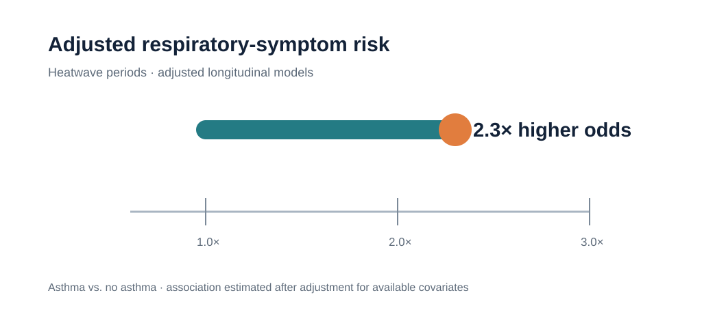
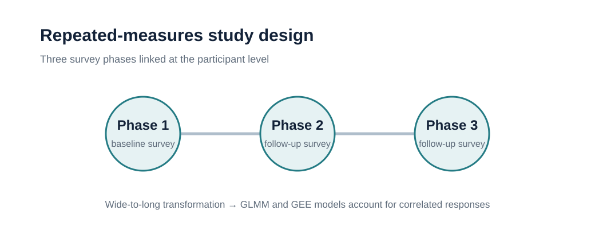

# Longitudinal Health Analysis: Heatwave-Related Respiratory Symptoms

**UC San Diego longitudinal public-health research** · **R, GLMM, GEE, longitudinal modeling**

> A privacy-safe portfolio version of a repeated-measures health analysis that identifies factors associated with heatwave-related symptoms across three survey phases.

## Executive Summary

I transformed multi-phase survey responses into a longitudinal analytical dataset, standardized free-text symptom information, and modeled repeated binary outcomes using generalized linear mixed models (GLMM) and generalized estimating equations (GEE). The analysis found that participants with asthma had approximately **2.3× higher adjusted odds** of respiratory symptoms during heatwave periods. The public repository includes the reusable workflow and aggregate evidence only; participant-level data remain restricted.

## My Role

- Reshaped multi-wave survey data from wide to long format for repeated-measures analysis.
- Cleaned and mapped clinical and free-text symptom fields into analysis-ready indicators.
- Built, compared, and diagnosed adjusted GLMM and GEE models in R.
- Synthesized model outputs into risk-relevant findings while preserving restricted data.

## Quick Review

| Review point | Portfolio evidence |
|---|---|
| Question | Which factors are associated with heatwave-related health impacts across repeated surveys? |
| Method | Data transformation, logistic GLMM, GEE sensitivity checks, model diagnostics |
| Key result | Asthma was associated with approximately **2.3×** higher adjusted odds of respiratory symptoms during heatwave periods |
| Privacy | No participant-level survey data or row-level outputs are public |

- [R analysis workflow](analysis/longitudinal_health_analysis.Rmd)
- [Methodology](docs/methodology.md)
- [Data privacy](docs/data_privacy.md)
- [Data-access guide](data/README.md)

## Research Question

How do participant characteristics, prior diagnoses, and survey phase relate to heatwave-associated symptoms when repeated observations from the same participant are modeled appropriately?

## Key Findings

- Repeated survey responses required a longitudinal approach rather than treating observations as independent.
- Free-text symptom descriptions were translated into structured symptom indicators for analysis.
- Asthma was associated with approximately **2.3× higher adjusted odds** of respiratory symptoms during heatwave periods.
- GLMM and GEE approaches supported evaluation of within-participant correlation and robustness to modeling assumptions.

<p align="center">
  
</p>

<p align="center">
  
</p>

## Research and Program Implication

The results point to pre-existing respiratory conditions as an important vulnerability factor during heatwave periods. In practice, this supports more targeted heat-health communication, symptom monitoring, and preparedness resources for higher-risk populations. These are observational associations from the study context, not causal estimates.

## Analysis and Documentation

| Resource | Description |
|---|---|
| [Longitudinal R workflow](analysis/longitudinal_health_analysis.Rmd) | Reproducible transformation, GLMM, GEE, and diagnostic workflow; runs only with authorized local data |
| [Methodology](docs/methodology.md) | Study design, modeling approach, and interpretation boundaries |
| [Data privacy](docs/data_privacy.md) | What is excluded and how restricted data are handled |
| [Data-access guide](data/README.md) | Expected local input structure in an approved environment |

## Methods at a Glance

1. Load authorized survey and symptom-scoring files from `data/private/`.
2. Standardize demographic, household, diagnosis, and symptom fields.
3. Reshape phase-specific records into participant-by-phase observations.
4. Fit adjusted logistic mixed-effects models with participant-level random effects.
5. Run GEE and diagnostic checks as complementary robustness analyses.
6. Interpret estimates as adjusted associations within the research setting.

## Data and Privacy

The underlying survey files are restricted by the project data-use agreement. They are deliberately absent from this repository and ignored through `.gitignore`. See [data/README.md](data/README.md) and [docs/data_privacy.md](docs/data_privacy.md) for the public-release boundary.

## Local Review

In an approved environment, place the authorized inputs in `data/private/` and render `analysis/longitudinal_health_analysis.Rmd`. Do not commit, upload, or publish the private inputs or participant-level outputs.

## Repository Structure

```text
.
├── analysis/       # reusable R workflow
├── data/           # access guidance; no restricted records
├── docs/           # methodology and privacy documentation
└── figures/        # aggregate portfolio visuals
```
